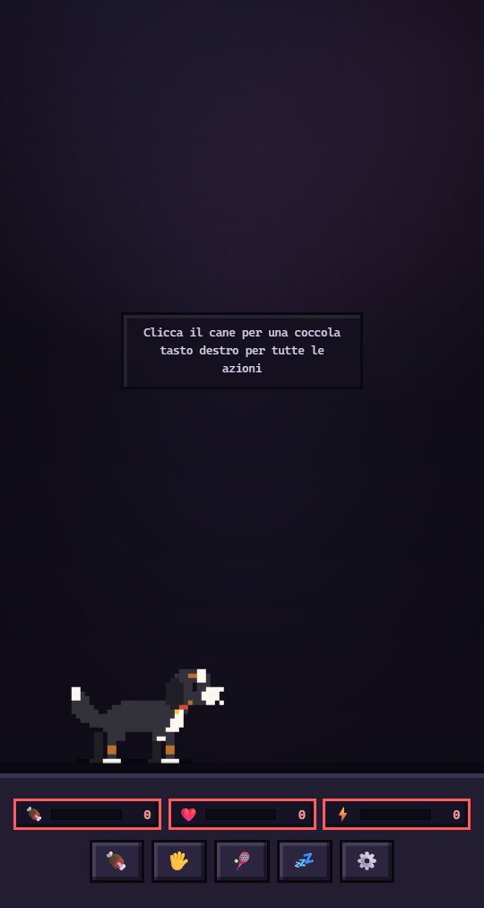

# Rocky 🐶 — il bovaro del Bernese a pixel che vive sulla barra

Rocky è un cane da compagnia a pochi pixel, in stile 8/16 bit: nero focato con petto,
muso e zampe bianchi, orecchie pendenti e coda folta. Vive appoggiato sulla barra e si
comanda **con un clic**: cibo, coccole, gioco, nanna e impostazioni, in un menu che non
resta mai appeso (si chiude da solo dopo qualche secondo).

Non servono dipendenze né build per la versione web: è HTML, CSS e JavaScript puri.



## Due modi per usarlo

### 1. Sulla barra delle applicazioni (finestra desktop)

È il modo per averlo davvero **dentro** la barra del sistema: una finestra trasparente,
senza bordi, sempre in primo piano, con il bordo inferiore a filo del fondo dello
schermo. Il cane è alto 48 px e poggia lì, cioè dentro la barra delle applicazioni;
il resto della finestra è trasparente e lascia passare i clic: sotto il puntatore
rispondono solo il cane, il suo menu e il pannello impostazioni. La finestra è larga
quanto lo schermo, così il cane **passeggia lungo la barra**: parte dal centro, va a
destra e a sinistra per un po' e si ferma prima della freccia «mostra desktop».

Il cane non poggia sul bordo dello schermo ma è sollevato di circa un quarto
dell'altezza della barra, così sta dentro la barra quasi attaccato al bordo superiore:
l'altezza della barra si ricava in `desktop/main.js` dalla differenza fra `bounds` e
`workArea`, e arriva alla pagina come `?lift=` (12 px se non specificato).

**Windows, il modo più semplice:** scarica lo ZIP (**Code → Download ZIP**), **estrailo**
e fai doppio clic su `avvia-rocky.bat`: la prima volta installa le dipendenze da solo,
poi avvia Rocky.

Da terminale (nella cartella del progetto):

```powershell
npm.cmd install
npm.cmd start
```

Se PowerShell rifiuta `npm` con l'errore su `npm.ps1` e l'esecuzione di script
disabilitata, usa `npm.cmd` come sopra (o il Prompt dei comandi): funziona senza
cambiare le impostazioni di sicurezza. Su macOS e Linux vanno bene
`npm install && npm start`.

Se compare `Electron failed to install correctly`, npm 11 o successivo ha bloccato lo
script di postinstallazione di Electron e il binario non è stato scaricato. Rimedio,
nella cartella del progetto:

```powershell
node node_modules\electron\install.js
npm.cmd start
```

In alternativa approva lo script e reinstalla: `npm.cmd install-scripts approve electron`
seguito da `npm.cmd install`.

Serve [Node.js](https://nodejs.org) installato. La finestra è larga quanto lo schermo e
alta **176 px**, appoggiata sul fondo, e resta sopra le altre applicazioni (se tocchi la
barra, la finestra si rialza da sola: `blur` e un timer richiamano `setAlwaysOnTop`);
si chiude con `Ctrl+C` nel
terminale o con `Alt+F4`. Dimensioni e posizione si cambiano con `WIDTH`, `HEIGHT` e il
calcolo di `x`/`y` in `desktop/main.js`: con `bounds` la finestra comprende la barra (è
la posizione predefinita, così il cane ci finisce dentro), con `workArea` resta sopra.

### Aggiornare il cane

Se hai clonato con git, nella cartella del progetto:

```powershell
git pull
npm.cmd start
```

Se invece hai estratto lo ZIP (dentro non c'è `.git`, quindi `git pull` risponde "not a
git repository"): riscarica lo ZIP e copia i file sopra la cartella del progetto, senza
toccare `node_modules`:

```powershell
cd $HOME\Downloads
Expand-Archive .\gang-main.zip -DestinationPath $HOME\rocky-new -Force
Copy-Item "$HOME\rocky-new\gang-main\*" "$HOME\Downloads\gang-main" -Recurse -Force
cd $HOME\Downloads\gang-main
npm.cmd start
```

Righe come `ERROR:cache_util_win.cc ... Accesso negato` o `Unable to create cache` non
sono un problema del cane: succedono quando resta aperta una copia precedente (o ne
partono due insieme) e Chromium non riesce a usare la cache. Ora l'app accetta una sola
copia alla volta: chiudi le finestre vecchie con `Alt+F4` e riavvia.

### 2. Nel browser

```bash
python3 -m http.server 3000
```

Poi apri <http://localhost:3000>. Qui vedi anche la barra delle statistiche completa;
aprendo `index.html?dock=1` ottieni la stessa vista trasparente della finestra desktop.

## Comandi (clic sul cane)

| Voce | Effetto |
| --- | --- |
| **Cibo** | +32 sazietà, ciotola e briciole (rifiuta se è pieno) |
| **Coccole** | +7 felicità, cuoricini e coda che scodinzola |
| **Gioca** | +20 felicità, −12 energia, −4 sazietà (serve almeno 15 di energia) |
| **Nanna** | rigenera energia mentre dorme; la voce diventa **Sveglia** |
| **Impostazioni** | cambia nome e mantello (Bernese, cioccolato, grigio focato) |

Un clic sul cane apre il menu e un altro clic lo richiude; se non lo usi si chiude da
solo dopo **6 secondi** (e il timer riparte se passi il mouse sui comandi). Il **doppio
clic** fa una coccola. Il menu si apre anche da tastiera: `Tab` fino al cane, poi
`Shift+F10` (o il tasto menu); `Esc` chiude.

Le statistiche calano col tempo (cibo in ~15 minuti, felicità ~20, energia ~25), anche a
finestra chiusa, e il cane se lo ricorda: tutto è salvato in `localStorage` sotto la
chiave `rocky-pet-v1`. Se lo trascuri troppo, te lo dice con il fumetto.

## Sotto il cofano

```
index.html        struttura della pagina e barra delle statistiche
css/styles.css    interfaccia retro (bordi spessi, monospace) e animazioni a scatti
js/sprite.js      il cane: sprite generato da una griglia di pixel
js/app.js         stato, decadimento statistiche, salvataggio, menu, interazioni
desktop/main.js   finestra Electron trasparente dentro la barra di sistema
desktop/preload.js  ponte che rende click-through le zone trasparenti
```

### Lo sprite

Rocky è disegnato su una griglia di **40×24 celle da 4 px** (viewBox 160×96). In
`js/sprite.js` il disegno è composto con quattro primitive — `box`, `oval`, `rowSpans`
(il tronco riga per riga, così la schiena è dritta e la pancia incavata) e `thickPath`
— e ogni cella diventa un `<rect>` (le righe di pixel uguali si fondono in un solo
rettangolo). Niente curve: solo blocchi, con `shape-rendering: crispEdges`.

Lo sprite è mostrato a **2 px per pixel** nella finestra sulla barra (cane di 80×48) e
a 5 px nel browser (200×120): solo scale intere, così i pixel restano quadrati.

Le parti sono gruppi separati (`.tail`, `.leg--near-hind`, `.head`, `.eye-open`,
`.tongue`…) e si animano per scatti, come nei giochi anni '80: la coda ha due frame
alternati, il corpo sobbalza di una cella, il cane salta a scatti.

Ci sono **cinque pose disegnate**: in piedi (`.pose--stand`), i due frame della
camminata (`.pose--walk-a`, `.pose--walk-b`), seduta (`.pose--sit`) e sdraiata
(`.pose--lie`). Nel passo le zampe sono ridisegnate nei due frame, non traslate: è
quello che rende leggibili le quattro zampe. Rocky si siede da solo se lo lasci tranquillo per un po' e,
quando va a dormire, si stende con la testa sulle zampe. Gli stati sono in `data-state`
su `.pet`: `idle`, `walk`, `sit`, `pet`, `eat`, `play`, `sleep`.

I colori del mantello sono variabili CSS — `--coat` (nero), `--coat-dark` (ombra),
`--cream` (bianco) e `--tan` (focatura) — cambiate dalle classi `body.coat-*`.

Lo stato salvato:

```js
{
  name: 'Rocky',
  coat: 'bernese',                         // bernese | cioccolato | grigiofocato
  stats: { cibo: 78, felicita: 82, energia: 90 },
  asleep: false,
  x: 216,                                  // posizione sulla barra
  lastSeen: 1762700000000
}
```

Altri punti da toccare: `DECAY` (velocità del decadimento) e `LINES` (battute del cane)
in `js/app.js`.

## Note

- Il progetto rispetta `prefers-reduced-motion`: con le animazioni ridotte il cane resta
  fermo ma tutte le funzioni rimangono.
- Nella finestra desktop le zone trasparenti sono trasparenti anche al mouse:
  `desktop/preload.js` avvisa il processo principale quando il puntatore è sul cane, sul
  menu o sul pannello, e solo lì la finestra cattura i clic. Senza preload (per esempio
  aprendo la pagina nel browser) non cambia nulla.
- La finestra Electron è trasparente e `alwaysOnTop`: su Windows può comparire sopra
  schermate intere se il sistema lo consente; su macOS richiede il permesso di
  accessibilità solo se in futuro si vorrà il click-through delle aree vuote.
